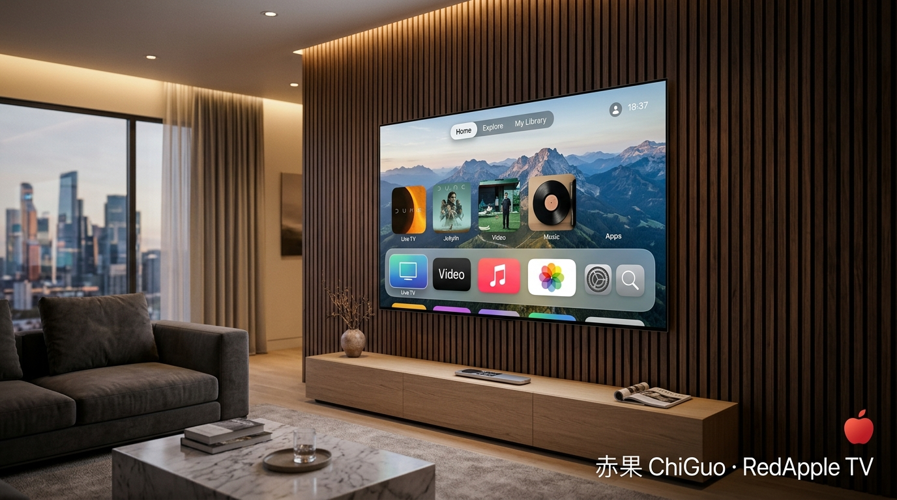
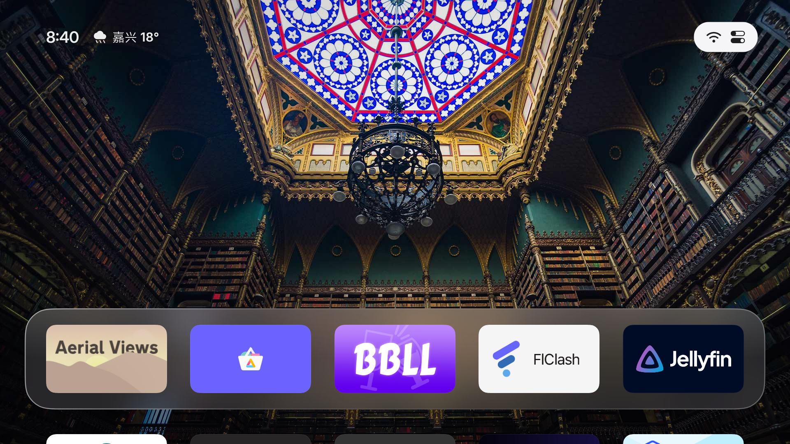
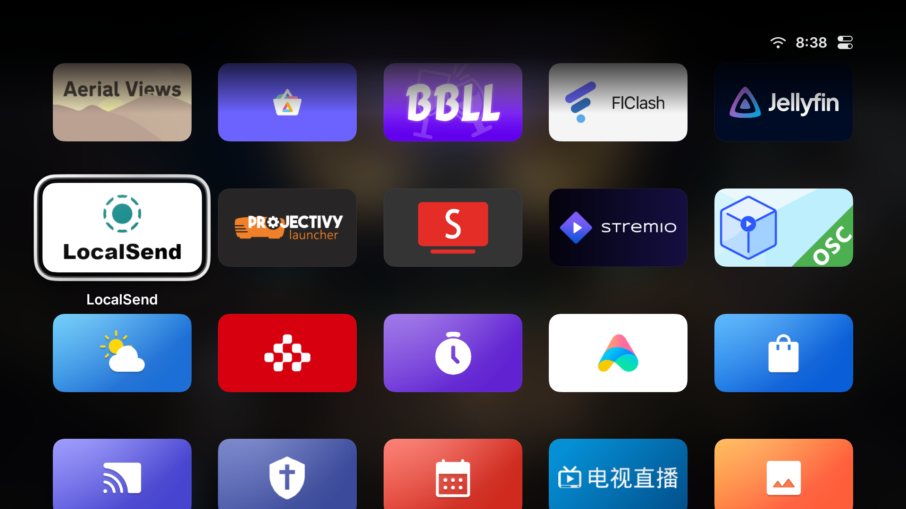
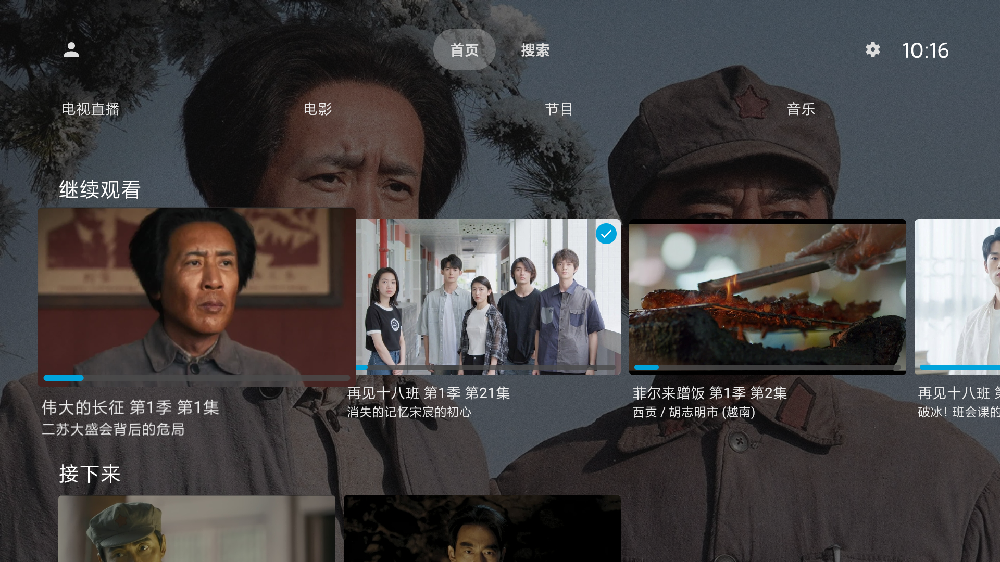
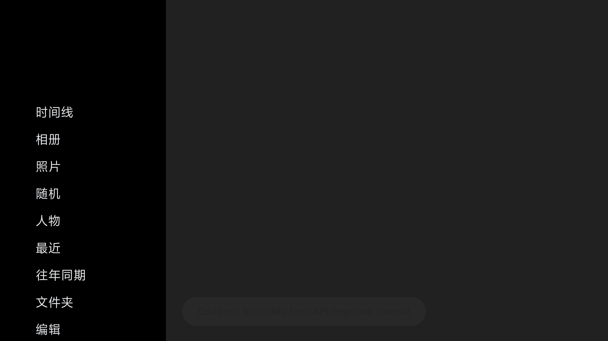
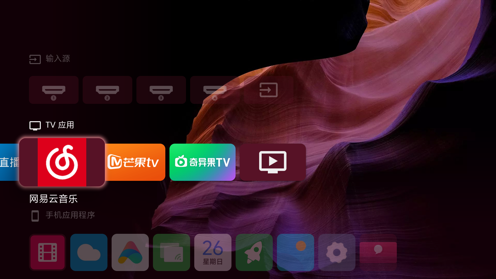
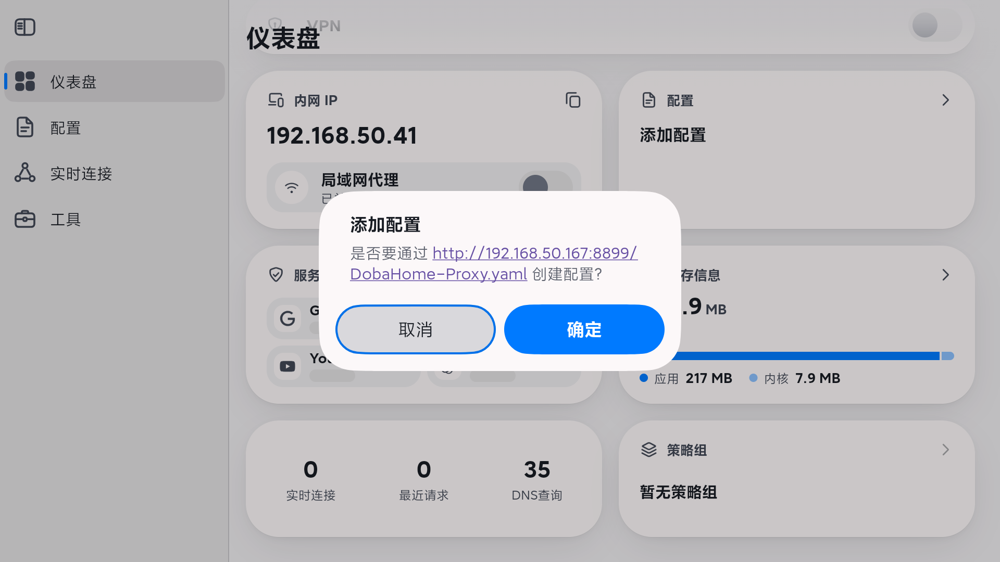
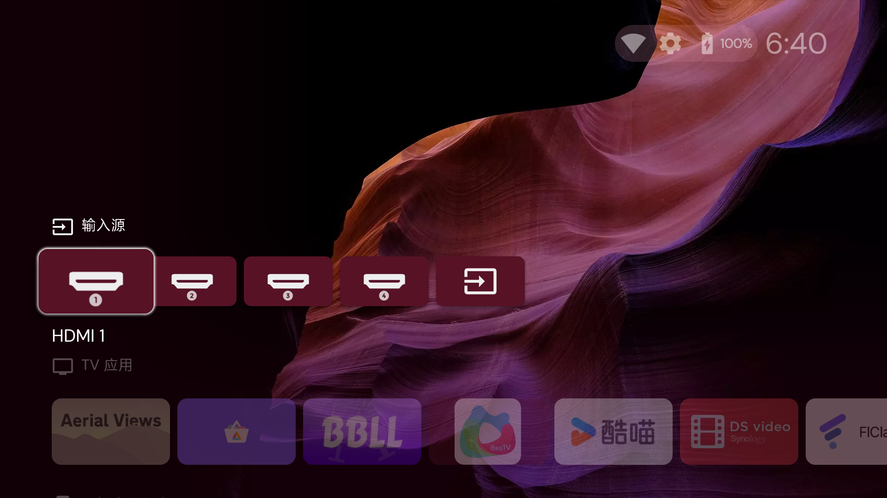
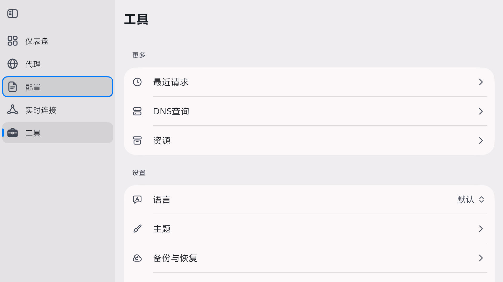

# 🍎 ChiGuo (赤果) · RedApple TV

<p align="center">
  
  
  
  
</p>

<p align="center">
  
</p>

<p align="center">
  <b>Transform ad-bloated Redmi and Xiaomi Android TVs into clean, fluid, Apple TV-grade private home entertainment hubs.</b><br>
  Zero Root · Zero Flashing · Reversible · Turnkey Solution
</p>

<p align="center">
  <a href="README.md">简体中文</a> · <b>English</b> · <a href="README.zh-TW.md">繁體中文</a> · <a href="README.ja.md">日本語</a> · <a href="README.ru.md">Русский</a> · <a href="README.es.md">Español</a>
</p>

---

## 🌟 Highlights & Core Capabilities

* 🍏 **Apple TV tvOS Aesthetic**: Replaces stock ad-heavy launchers with open-source **Aerial TV (v1.41)**, delivering 3D focus animations, frosted glass dock, Top Shelf previews, and a translucent Control Center;
* 🏞️ **Native 4K Aerial Screensavers**: Seamlessly integrates **114 Apple TV 4K slow-motion aerial screensavers** directly into the desktop, eliminating redundant standalone screensaver apps;
* 🧹 **Surgical Debloating**: Safely uninstalls **18 system telemetry services, ad injectors, gaming halls, and push daemons**, boosting free storage to **15 GB** and free RAM to **740 MB+**;
* ⚡ **Double UI Responsiveness**: Lowers animation scales to **0.5x** and pre-compiles all core apps into pure native machine code via **AOT Speed compilation (`-m speed`)**, eliminating JIT stutter and lag;
* 🍿 **Private 4K Theater (Jellyfin)**: Direct streaming over dual-stack native IPv6 (17ms ping), leveraging built-in LibVLC / ExoPlayer engines with Dolby Vision, HDR, and Bitstream Audio Passthrough;
* 📷 **Family Memories on Big Screen (Immich TV)**: Brings **Immich Android TV (v6.2.0)** with automated zero-touch API key pairing, timeline browsing, facial recognition clusters, and 4K random slideshows;
* 📡 **Low-Latency IPTV Live Streams**: Hand-curated 112 HLS stream list with hardware decoding, specifically resolving the 5-second video loop issue common on TV chipsets;
* 🌐 **Breakthrough Proxy Architecture**: Overcomes the classic Android TV pitfall where proxy TUN interfaces create an IPv6 blackhole that breaks local NAS and IPTV streaming. Implements **FlClash Whitelist App Routing** (only SmartTube enters the VPN, while Jellyfin, IPTV, and LAN run directly);
* 🔒 **LAN Port Security**: Deregisters persistent ADB daemons to ensure port 5555 is not left exposed after TV reboots.

---

## 📸 Visual Gallery (Live TV Screenshots)

> [!NOTE]
> All screenshots are captured directly from a real Redmi TV (`MiTV-MFTP0`, Android 9 / build 6129).

### 1. Desktop Aesthetic & Control Center
| Apple TV Frosted Glass Desktop (Aerial TV) | Translucent Control Center |
| :---: | :---: |
|  |  |
| *Frosted dock, live clock/local weather, Top Shelf preview* | *Instant signal switching (HDMI/consoles), dark mode, network info* |

### 2. Private Cloud Home Theater & Family Photos
| Jellyfin 4K Private Theater Poster Wall | Immich TV Big-Screen Client |
| :---: | :---: |
|  |  |
| *Native IPv6 dual-stack direct play (17ms ping), instant poster wall* | *Local photo albums, timeline view, facial clusters, 4K slideshows* |

### 3. Streaming & App-Level Whitelist Routing
| SmartTube (4K YouTube TV Client) | FlClash Whitelist Access Control |
| :---: | :---: |
|  |  |
| *Ad-free AV1/VP9 4K 60FPS hardware decoded playback* | *Only SmartTube enters VPN; preserves native IPv6 & LAN for theater* |

### 4. Live TV & Network Dashboard
| My-TV (Ultra Low-Latency IPTV) | FlClash Core Dashboard & Auto-Test |
| :---: | :---: |
|  |  |
| *Over 112 live HD channels, instant channel changing* | *Multi-protocol node aggregation (VLESS, Hy2, Trojan), 300s auto-urltest* |

---

## 📊 Before & After Benchmarks

| Metric | Stock Xiaomi/Redmi TV | ChiGuo Optimized System | Improvement |
| :--- | :--- | :--- | :--- |
| **Boot & Desktop** | 15~30s mandatory ads + feed bloat | **Instant Aerial TV with tvOS frosted dock** | Zero ads, instant clean desktop |
| **Screensaver** | Static commercial banner ads | **114 Apple TV 4K aerial drone videos** | Cinematic 4K slow-motion beauty |
| **Free Storage** | ~7.8 GB (choked by bloatware) | **15.0 GB** | **Double the usable storage** |
| **Free Memory** | 200~300 MB (bloat background tasks) | **740 MB+** (during IPTV playback) | Fluid multitasking without memory kills |
| **UI Responsiveness**| 1.0x sluggish animations, dropped frames | **0.5x scales + Full AOT Speed Native Code** | Instant tactile remote control response |
| **Proxy Routing** | TUN intercepts & blackholes IPv6 | **FlClash Whitelist Mode (SmartTube only)** | 4K YouTube without breaking Jellyfin / IPv6 |
| **Bilibili (BBLL)** | Error -412 API rate-limited | **BBLL v1.5.5 (Wbi Signature Patched)** | 4K 60FPS + real-time danmaku |
| **Port Security** | Debugging port randomly exposed | **Deregistered `keep_adb` daemon** | Port 5555 closed upon restart |

---

## 🛠️ Quick Start Guide

### 1. Prerequisites
* Connect the TV and your computer to the **same 5GHz Wi-Fi** (negotiated speed reaches 866Mbps; avoid 100Mbps Ethernet cables on Redmi TVs);
* On the TV, go to: **Settings → About → Click "MIUI TV Version" 7 times** to unlock Developer Options;
* Enable: **Settings → Account & Security → ADB Debugging → Allow**.

### 2. Helper Script Utilities (`tv_helper.sh`)
```bash
# Check TV status, storage, memory, and active window
./tv_helper.sh <TV_IP> status

# Capture lossless HD screenshot (bypasses Xiaomi 45-byte stdout corruption)
./tv_helper.sh <TV_IP> screenshot

# Push IPTV playlist to TV
./tv_helper.sh <TV_IP> push-iptv
```

---

## ⚙️ Advanced System Tuning

### 1. Animation Scaling & AOT Pre-compilation
Run via wireless ADB:

```bash
# Set animation scales to 0.5x
adb -s <TV_IP>:5555 shell settings put global window_animation_scale 0.5
adb -s <TV_IP>:5555 shell settings put global transition_animation_scale 0.5
adb -s <TV_IP>:5555 shell settings put global animator_duration_scale 0.5

# Compile core apps to native machine code
adb -s <TV_IP>:5555 shell cmd package compile -m speed -f app.orchard.tv
adb -s <TV_IP>:5555 shell cmd package compile -m speed -f org.jellyfin.androidtv
adb -s <TV_IP>:5555 shell cmd package compile -m speed -f nl.giejay.android.tv.immich
adb -s <TV_IP>:5555 shell cmd package compile -m speed -f com.github.mytv.android
adb -s <TV_IP>:5555 shell cmd package compile -m speed -f com.V2.blb5
```

### 2. FlClash Whitelist App Routing
To enable 4K YouTube without breaking your LAN NAS and IPv6:
1. Open **FlClash** on the TV;
2. Navigate to **Tools → Settings → Access Control**;
3. Switch Mode to **Whitelist Mode (Only selected apps enter VPN)**;
4. Check **SmartTube** only and click **Save**;
5. Start VPN from Dashboard. SmartTube gets accelerated while Jellyfin, Immich, and IPTV stay native and fast.
> See reference template: [`tools/clash_template_androidtv.yaml`](tools/clash_template_androidtv.yaml).

### 3. Port Security Best Practice
Deregister Aerial's persistent ADB guard so port 5555 closes automatically upon reboot:

```bash
adb -s <TV_IP>:5555 shell am broadcast -a app.orchard.tv.CONFIG -n app.orchard.tv/.guard.ConfigReceiver --ez keep_adb false
```

---

## ❓ FAQ & Troubleshooting

<details>
<summary><b>Q1: Why does SmartTube say "Cannot connect" or spin forever?</b></summary>

**A:** FlClash VPN was not running after the TV rebooted. Open FlClash on the TV, turn on the VPN switch, and enable **"Auto-start"** and **"Connect on Start"** under Tools → General.
</details>

<details>
<summary><b>Q2: Why does Jellyfin fail to connect when the proxy is turned on?</b></summary>

**A:** TUN interfaces on Android TV blackhole IPv6 traffic when IPv6 routing is disabled in proxy configs. Set FlClash to **Whitelist Access Control Mode** and select SmartTube only. Jellyfin will bypass the VPN and connect over native dual-stack IPv6 instantly.
</details>

<details>
<summary><b>Q3: Can this be deployed on Huawei HarmonyOS Smart Screens?</b></summary>

**A:** **No.** Huawei locks down its launcher, completely omits the system-level `VpnService` module (preventing FlClash and VPN tools from creating TUN interfaces), and blocks network ADB. HarmonyOS NEXT also removes AOSP APK compatibility entirely. See detailed technical report in [2026-10-24 Notes](docs/调试记录-2026-10-24.md).
</details>

---

## 📄 License & Credits

Released under the [MIT License](LICENSE).

Special thanks to the outstanding open-source projects:
* [pengchujin/aerial-tv](https://github.com/pengchujin/aerial-tv)
* [jellyfin/jellyfin-androidtv](https://github.com/jellyfin/jellyfin-androidtv)
* [giejay/Immich-Android-TV](https://github.com/giejay/Immich-Android-TV)
* [chen08209/FlClash](https://github.com/chen08209/FlClash)
* [yuliskov/SmartTube](https://github.com/yuliskov/SmartTube)
* [bilibili-integrate/BBLL](https://github.com/bilibili-integrate/BBLL)
* [yaoxieyoulei/mytv-android](https://github.com/yaoxieyoulei/mytv-android)
