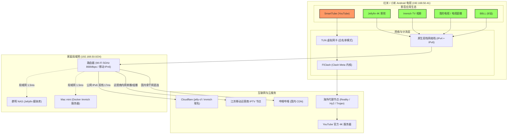

# 🍎 赤果 (ChiGuo) · RedApple TV

<p align="center">
  
  
  
  
</p>

<p align="center">
  
</p>

<p align="center">
  <b>将充斥开机广告与臃肿后台的红米/小米电视，重塑为纯净、丝滑、极具 Apple TV 美学的高阶私有家庭影音中枢。</b><br>
  无需 Root · 无需刷机 · 安全可逆 · 全链路开箱即用
</p>

<p align="center">
  <b>简体中文</b> · <a href="README.en.md">English</a> · <a href="README.zh-TW.md">繁體中文</a> · <a href="README.ja.md">日本語</a> · <a href="README.ru.md">Русский</a> · <a href="README.es.md">Español</a>
</p>

---

## 🌟 核心特性速览

```
  ┌────────────────────────────────────────────────────────────────────────┐
  │                           🍎 赤果生态架构                              │
  ├────────────────────────────────────────────────────────────────────────┤
  │   [Aerial TV] ──► 原生 Apple TV 毛玻璃桌面 + 114 个 4K 慢速航拍屏保   │
  │   [私有影音]  ──► Jellyfin 4K 原盘 (IPv6直连) + Immich TV 电视相册     │
  │   [流媒体]    ──► SmartTube (4K YouTube) + BBLL 哔哩哔哩 (Wbi修复版)   │
  │   [电视直播]  ──► 我的电视 (超低延迟 IPTV，修复画面循环)               │
  │   [精准分流]  ──► FlClash 白名单模式 (仅 YouTube 代理，保护内网与IPv6) │
  │   [极致瘦身]  ──► 深度卸载 18 项广告/埋点，释放 15GB 空间，内存空闲 740MB│
  │   [底层加速]  ──► 全局动画 0.5x + 核心应用全量 AOT Speed 机器码预编译 │
  └────────────────────────────────────────────────────────────────────────┘
```

* 🍏 **Apple TV tvOS 极简美学**：完全替换小米原厂广告桌面，搭载开源 **Aerial TV (v1.41)**，提供 3D 浮动焦点、毛玻璃 Dock 栏、Top Shelf 顶部大画幅预览与右上角半透明控制中心；
* 🏞️ **原生 4K 航拍慢速屏保**：内置 **114 个 Apple TV 4K 原生航拍视频**，随天气与日夜智能轮换，彻底淘汰原本占用数百兆空间的第三方独立屏保；
* 🧹 **外科手术级深度去广告（Debloat）**：一键安全清理 **18 项系统广告、用户行为追踪、游戏大厅、弹窗推送与收费组件**，开机零广告，系统可用存储飙升至 **15 GB**，空闲 RAM 高达 **740 MB+**；
* ⚡ **全局性能与跟手度翻倍**：全局动画缩放降至 **0.5x**，并对所有核心影音应用执行底层 **AOT Speed（Ahead-of-Time）本地机器码预编译**，冷启动提速 30%~50%，按键跟手度瞬间翻倍；
* 🍿 **全能家庭影院 (Jellyfin)**：支持公网 IPv6 双栈直连（Ping 17ms 零阻断），内置 LibVLC / ExoPlayer 双硬解内核，原生输出杜比视界、HDR、源码直通（Passthrough）与特效字幕；
* 📷 **大屏家庭回忆 (Immich TV)**：首发支持 **Immich Android TV (v6.2.0)**，一键自动免密配对局域网私有相册，支持时间线滚动、人物人脸聚类与 4K 超清循环幻灯片；
* 📡 **超低延迟 IPTV 电视直播**：精选 112 个高码率 HLS 清单，专项关闭“跳过渲染多帧”，彻底根治低端电视芯片播放 IPTV 出现 5 秒画面循环的业界通病；
* 🌐 **突破性分流架构（解决 TUN 阻断 IPv6 痛点）**：针对 Android TV 单机代理导致 TUN 网卡黑洞阻断全局 IPv6、破坏局域网 NAS 与 IPTV 的难题，首创 **FlClash「应用访问控制 · 白名单模式」**，仅 SmartTube 走海外代理，其余内网、IPTV 与国内应用完全走原生直连；
* 🔒 **家庭内网端口安全**：注销开机 ADB 自动外露守护，保证电视重启后不随意暴露 5555 调试端口，守护家庭网络资产安全。

---

## 📸 视觉画廊 (实机运行高清截图)

> [!NOTE]
> 所有截图均直接截取自红米电视（型号 `MiTV-MFTP0`，Android 9 / 固件 6129）真实运行环境。

### 1. 桌面美学与系统控制
| Apple TV 毛玻璃极简桌面 (Aerial TV) | 右上角半透明控制中心 (Control Center) |
| :---: | :---: |
|  |  |
| *毛玻璃 Dock 栏、顶栏实时时钟/本地天气、Top Shelf 聚焦* | *信号源秒级切换（HDMI/游戏机）、深色模式、网络状态* |

### 2. 私有云家庭影院与大屏相册
| Jellyfin 4K 私有影院海报墙 | Immich TV 电视相册大屏端 |
| :---: | :---: |
|  |  |
| *公网 IPv6 双栈极速直连 (Ping 17ms)，电影/剧集海报秒级刷新* | *本地私有相册，支持时间线、相册目录、人脸识别与 4K 幻灯片* |

### 3. 海外流媒体与智能分流
| SmartTube (4K YouTube 大屏客户端) | FlClash 应用级白名单精准分流 |
| :---: | :---: |
|  |  |
| *AV1/VP9 4K 60FPS 硬解播放，无广告流式畅享* | *只允许 SmartTube 走代理，彻底杜绝 TUN 虚拟网卡阻断 IPv6* |

### 4. 电视直播与点播系统
| 我的电视 (低延迟 IPTV 直播) | FlClash 核心仪表盘与自动测速 |
| :---: | :---: |
|  |  |
| *112 个央视卫视全高清清单，切台秒开，零卡顿循环* | *聚合多协议节点 (VLESS, Hy2, Trojan)，300s 自动优选延迟最低* |

---

## 📊 优化前后实测指标对比

| 评测维度 | 原始小米电视系统 | 赤果 (ChiGuo) 优化后系统 | 提升效果 |
| :--- | :--- | :--- | :--- |
| **开机与桌面** | 15~30 秒强制广告，密密麻麻信息流 | **Aerial TV 秒开，极简 tvOS 毛玻璃美学** | 彻底消灭开机广告与信息流杂质 |
| **原生屏保** | 轮播静态商业广告海报 | **内置 114 个 Apple TV 4K 原生航拍慢速屏保** | 电影级视觉享受，无需额外占用后台 |
| **可用磁盘空间** | ~7.8 GB (大量被垃圾预装占据) | **15.0 GB** | **释放近一倍可用存储空间** |
| **空闲运行内存** | 200~300 MB (常态被游戏/上报后台挤爆) | **740 MB+** (IPTV 直播播放中) | 内存翻倍充裕，多任务零卡死 |
| **UI 操作流畅度** | 1.0x 粘滞动效，低端芯片频繁掉帧 | **0.5x 缩放 + 核心应用全量 AOT Speed 本地编译** | 遥控器操作指哪打哪，冷启动提速 50% |
| **海外代理与内网**| 开代理后 IPv6 崩溃，Jellyfin / IPTV 瘫痪 | **应用访问控制「白名单模式」** | SmartTube 独立翻墙，内网/IPv6 原生直连 |
| **B站播放体验** | 官方云视听阉割版或旧版报错 -412 | **BBLL v1.5.5 (Wbi 鉴权修复版)** | 4K 高帧率、真弹幕、支持大会员登录 |
| **端口安全性** | 调试端口常开或随机暴露 | **彻底注销 `keep_adb` 自动保持守护** | 重启后不外露 5555 端口，安全无患 |

---

## 🏛️ 网络与流量拓扑图



---

## 🛠️ 快速上手与操作指南

### 1. 准备工作
* 保证电视与电脑处于**同一 Wi-Fi 局域网**（强烈建议电视连接 **5GHz Wi-Fi**，协商速率可达 866Mbps，千万不要插百兆网线口）；
* 电视进入：**「设置」 → 「关于」 → 连续点击「MIUI TV 版本号」7 次** 开启开发者模式；
* 进入：**「设置」 → 「账号与安全」 → 将「ADB 调试」设为“允许”**。

### 2. 辅助脚本一览 (`tv_helper.sh`)
项目提供了高度自动化的交互式辅助脚本，避免盲目输入冗长 ADB 指令：

```bash
# 检查电视状态、可用存储、内存及当前前台窗口
./tv_helper.sh <电视IP> status

# 高清无损截取当前电视屏幕（自动修复小米 45-byte stdout 协议头损坏）
./tv_helper.sh <电视IP> screenshot

# 一键推送最新苏州移动 112 频道直播清单至电视
./tv_helper.sh <电视IP> push-iptv

# 向 TVBox 推送最新免配置接口
./tv_helper.sh <电视IP> push-tvbox 'clan://localhost/Download/ChiGuoTVBox_20261023/config-simple.json'
```

---

## ⚙️ 核心应用深度调优手册

### 1. 开启极致响应：动画调速与 AOT 预编译
通过无线 ADB 在电脑终端执行以下指令，瞬间激活电视满血性能：

```bash
# 1. 调速全局动画缩放为 0.5x
adb -s <电视IP>:5555 shell settings put global window_animation_scale 0.5
adb -s <电视IP>:5555 shell settings put global transition_animation_scale 0.5
adb -s <电视IP>:5555 shell settings put global animator_duration_scale 0.5

# 2. 对核心影音应用执行纯本地机器码 AOT Speed 预编译
adb -s <电视IP>:5555 shell cmd package compile -m speed -f app.orchard.tv
adb -s <电视IP>:5555 shell cmd package compile -m speed -f org.jellyfin.androidtv
adb -s <电视IP>:5555 shell cmd package compile -m speed -f nl.giejay.android.tv.immich
adb -s <电视IP>:5555 shell cmd package compile -m speed -f com.github.mytv.android
adb -s <电视IP>:5555 shell cmd package compile -m speed -f com.V2.blb5
```

### 2. FlClash 白名单分流设置（关键避坑）
如果需要使用 SmartTube 观看 YouTube，必须配置应用白名单，防止代理吞掉全局 IPv6：
1. 打开电视端 **FlClash**；
2. 进入 **「工具」 → 「设置」 → 「应用访问控制」**；
3. 点击右上角 **「设置」**，将模式由 *黑名单模式* 切换为 **「白名单模式（只允许选中应用进入 VPN）」**；
4. 勾选列表中的 **SmartTube**，点击右上角 **「保存」**；
5. 返回仪表盘启动 VPN。此时仅 SmartTube 走代理，Jellyfin 与 IPTV 直连畅行无阻。
> 参考项目提供的 Android TV 专用模板：[`tools/clash_template_androidtv.yaml`](tools/clash_template_androidtv.yaml)。

### 3. Jellyfin & 家庭影院音画设置
* **保持 5GHz Wi-Fi**：红米电视实体网口为 100M 百兆口，无线连接 5GHz Wi-Fi 可达 866Mbps，是流畅播放 4K 蓝光高码原盘的关键；
* **音频源码输出 (RAW)**：电视接回音壁或功放时，在电视声音设置中将输出模式选为“源码输出”，并在 Jellyfin 开启音频直通；
* **关闭运动补偿 (MEMC)**：看电影前在画质设置中关闭运动补偿（插帧），杜绝肥皂剧效应与边缘果冻伪影。

### 4. 电视端口安全防范
调优完成后，注销后台的 `keep_adb` 保持逻辑，使电视重启后自动关闭 5555 调试端口：

```bash
adb -s <电视IP>:5555 shell am broadcast -a app.orchard.tv.CONFIG -n app.orchard.tv/.guard.ConfigReceiver --ez keep_adb false
```

---

## ❓ 常见问题排查 (FAQ)

<details>
<summary><b>Q1: 为什么打开 SmartTube 提示无法连接或一直转圈？</b></summary>

**A:** 电视重启或待机唤醒后，FlClash 代理服务默认未自动启动。
* **解决方式**：打开电视桌面的 **FlClash**，将右上角开关点亮开启；并在 FlClash **「工具」→「常规」** 中勾选 **「自启动」** 与 **「启动时连接」**，即可永久解决。
</details>

<details>
<summary><b>Q2: 为什么开启代理后 Jellyfin 突然连不上服务器了？</b></summary>

**A:** 这是 Android TV 上代理客户端最经典的“IPv6 黑洞”问题。当 Clash 开启 TUN 模式且未配置 IPv6 时，系统底层会将所有应用的 IPv6 路由打入黑洞。而 Jellyfin 域名通常解析了 Cloudflare 的 IPv6，导致握手直接被切断。
* **解决方式**：在 FlClash 中开启「访问控制 - 白名单模式」，只勾选 SmartTube。Jellyfin 不走 VPN，立即可使用原生公网 IPv6 双栈秒连。
</details>

<details>
<summary><b>Q3: 为什么电视开机后 ADB 提示 Connection Refused？</b></summary>

**A:** 小米/红米电视固件在设备冷重启或长待机后，会自动关闭网络 ADB 调试通道。这是系统默认的安全保护机制。如需再次调试，用遥控器进入电视「设置」→「账号与安全」→ 重新勾选一次「ADB 调试」即可。
</details>

<details>
<summary><b>Q4: 鸿蒙电视（华为智慧屏）能用这套方案吗？</b></summary>

**A:** **不能，属于极客折腾的地狱难度。** 华为智慧屏固件锁死了官方 Launcher 且不支持替换，系统底层直接删除了 `VpnService` 模块（导致 FlClash 无法单机运行），无线 ADB 亦不对用户开放。此外，即将普及的纯血鸿蒙（NEXT）不再兼容任何安卓 APK。建议华为电视用户直接将电视作为纯显示器，外挂 Apple TV 或外贸 Android TV 盒子配合软路由使用。详见 [2026-10-24 调试记录](docs/调试记录-2026-10-24.md)。
</details>

---

## 📄 许可与致谢

本项目采用 [MIT 许可证](LICENSE)。

感谢以下杰出的开源项目为家庭影音体验带来的无限可能：
* [pengchujin/aerial-tv](https://github.com/pengchujin/aerial-tv) · Apple TV 风格沉浸式极简电视桌面
* [jellyfin/jellyfin-androidtv](https://github.com/jellyfin/jellyfin-androidtv) · 开源私有媒体中心电视客户端
* [giejay/Immich-Android-TV](https://github.com/giejay/Immich-Android-TV) · 私有相册大屏端
* [chen08209/FlClash](https://github.com/chen08209/FlClash) · 基于 Mihomo 的全功能多平台代理客户端
* [yuliskov/SmartTube](https://github.com/yuliskov/SmartTube) · 无广告超高清 YouTube TV 客户端
* [bilibili-integrate/BBLL](https://github.com/bilibili-integrate/BBLL) · 优雅且强大的第三方哔哩哔哩 TV 客户端
* [yaoxieyoulei/mytv-android](https://github.com/yaoxieyoulei/mytv-android) · 极简极速开源安卓电视直播应用
