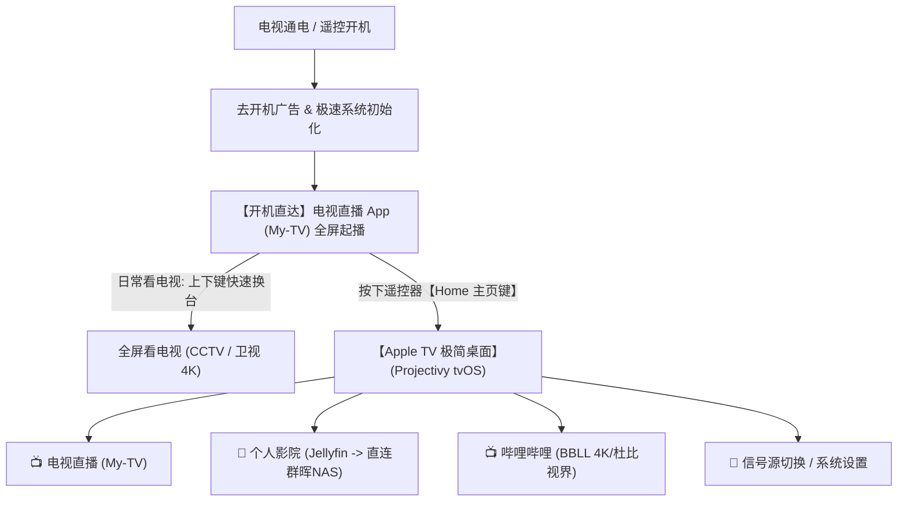
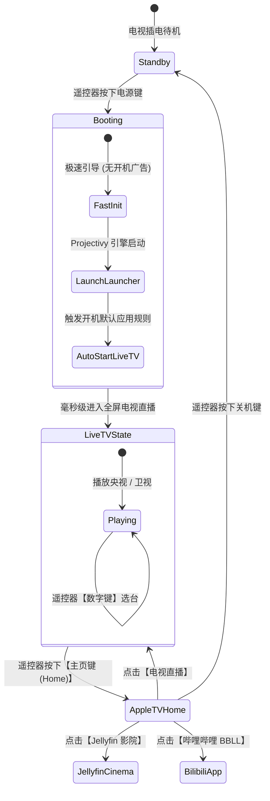

# 红米电视“Apple TV 体验”定制系统实施方案

本方案旨在将**红米智能电视**在不破坏硬件保修、不承担刷机变砖风险的前提下，通过底层 ADB 深度优化与自动化部署，打造成一台**开机直达电视直播、拥有 Apple TV (tvOS) 极简交互、融合 B站 4K 与群晖 Jellyfin 影院**的高品质家庭影音终端。

---

## 1. 整体架构与设计原则



### 核心设计原则
1. **绝对安全（零变砖风险）**：
   - 绝不改动 Bootloader 与底层内核分区。
   - 采用 `pm disable-user --user 0` 停用级别，底层安装包完整保留，所有系统级底层驱动（MEMC 运动补偿、画质引擎、遥控器蓝牙栈）完好无损。
2. **完全可逆（一键秒级还原）**：
   - 操作前自动完整备份电视当前的 Package 清单。
   - 配套生成 `restore_redmi_tv.sh` 一键还原脚本，随时可无缝恢复小米官方出厂状态。
3. **老幼友好（开机即播）**：
   - 通电直接进电视节目，无需手动点选图标，长辈使用体验与传统电视完全一致。
   - 按 Home 键退回极简桌面，无任何商业广告和复杂瀑布流推荐。

---

## 2. 软件选型与技术规格

| 模块 | 软件名称 | 版本与技术规格 | 核心功能与调校要点 |
| :--- | :--- | :--- | :--- |
| **系统桌面** | **Projectivy Launcher** | 最新开源多架构定制版 | • 配置 **tvOS 风格主题**（大圆角拟真卡片、聚焦放大动效、毛玻璃高斯模糊壁纸）<br>• 启用开机自启看电视 App 机制<br>• 劫持/重定向 Home 键到极简桌面 |
| **开机看电视** | **My-TV (我的电视)** | Android TV 硬件解码专用版 | • 纯净无广告、体积仅约 10MB<br>• 聚合 CCTV-1~16、各大卫视高清/4K 超清源<br>• 响应速度毫秒级，支持遥控器数字选台、频道记忆 |
| **B站客户端** | **BBLL** | Android TV 专用版 | • 无任何开屏与前贴片广告<br>• 最高支持 4K 120Hz、8K、杜比视界与杜比全景声<br>• 弹幕字号、透明度与屏蔽词完全可调<br>• 支持扫码登录 B 站大会员账号 |
| **私有影院** | **Jellyfin for Android TV** | 官方 TV 版客户端 | • 直连局域网群晖 NAS (`192.0.2.20:8096`)<br>• 媲美 Apple TV Infuse 的高清海报墙与影视元数据展示<br>• 支持 4K HDR 硬解直通，多设备续播进度同步 |

---

## 3. 系统底层精简清单（黑白名单安全规范）

> [!IMPORTANT]
> 系统优化严格遵守黑白名单机制。绝不触碰遥控器通信、系统核心框架与输入法组件。

### 3.1 待停用黑名单（去除广告与垃圾后台）
- **广告与数据采集**：
  - `com.miui.systemAdSolution`（小米系统广告核心服务）
  - `com.xiaomi.mitv.advertise`（开机/屏保广告）
  - `com.xiaomi.statistic`（系统大数据上报追踪）
  - `com.xiaomi.analytics`（统计分析组件）
- **无用预装与推送组件**：
  - `com.xiaomi.mitv.upgrade`（阻止未经许可的强制 OTA 静默更新破坏配置）
  - `com.xiaomi.mitv.shop`（电视商城）
  - `com.xiaomi.mitv.payment`（米币/电视支付无用组件）
  - `com.duokan.videodownload`（多看后台离线下载）
  - `com.xiaomi.gamecenter.pad`（电视游戏中心）
- **原生臃肿桌面**：
  - `com.mitv.tvhome`（原厂满屏广告瀑布流桌面，在第三方桌面就绪后安全停用）

### 3.2 严禁触碰的系统白名单（保障硬件与遥控器稳定）
- `com.xiaomi.mitv.bluetoothremote` / `com.xiaomi.mitv.input`（蓝牙遥控器连接与语音通信栈）
- `com.xiaomi.mitv.settings`（原生核心硬件设置：画质、音效、网络、蓝牙）
- `com.android.inputmethod.pinyin`（系统输入法）
- `android` / `com.android.systemui` / `com.android.providers.settings`（系统核心驱动与状态栏）

---

## 4. 交互流程与状态机



---

## 5. 实施路线图（五阶段执行计划）

### 阶段一：环境握手与数据备份
1. 在红米电视上启用【开发者选项】与【ADB 调试】。
2. 电脑端通过 ADB 握手连接电视（目标 IP：`192.0.2.10`）。
3. 自动抓取电视系统信息（Android 版本、SoC 型号、分辨率），并导出当前完整应用清单作为安全备份。

### 阶段二：底层广告与后台净化
1. 执行白名单校验机制，逐一停用广告服务、数据采集与无用推送包。
2. 优化系统全局动画倍率（调为 0.5x），降低过渡渲染延迟。
3. 检查系统可用 RAM 提升情况。

### 阶段三：核心四大套件推送与授权
1. 通过 ADB 向电视静默安装：
   - `Projectivy Launcher`
   - `My-TV (我的电视)`
   - `BBLL (B站TV版)`
   - `Jellyfin for Android TV`
2. 授予 Projectivy Launcher 必要的前台和无障碍辅助权限，确保 Home 键能够被稳定捕获。

### 阶段四：Apple TV 界面定制与开机直达联动
1. 载入 Projectivy 拟真 tvOS 主题与高精壁纸。
2. 布局 Dock 栏，隐藏所有无关系统应用，仅展示：**电视直播、Jellyfin、BBLL、系统设置**。
3. 在桌面设置中配置 **“开机自启应用” -> 指定为 `My-TV`**。
4. 停用原生桌面 `com.mitv.tvhome`。

### 阶段五：整体验收与生成灾备脚本
1. 电视断电冷启动测试：验证是否无广告直接全屏起播电视。
2. 遥控器 Home 键测试：验证是否秒级返回 Apple 极简桌面。
3. 自动在本地生成 `restore_redmi_tv.sh`，确保随时可一键撤销所有变更。

---

## 6. 应急灾备预案（一键还原机制）

如果未来需要恢复官方原厂系统（例如保修或需要使用某些小米特有功能），只需在电脑终端运行以下命令：

```bash
adb connect 192.0.2.10:5555
adb shell pm enable com.mitv.tvhome
adb shell pm enable com.xiaomi.mitv.upgrade
adb shell cmd package set-home-activity com.mitv.tvhome/.MainActivity
```
原生桌面与全部系统组件将瞬间完整复原，无需恢复出厂设置。
